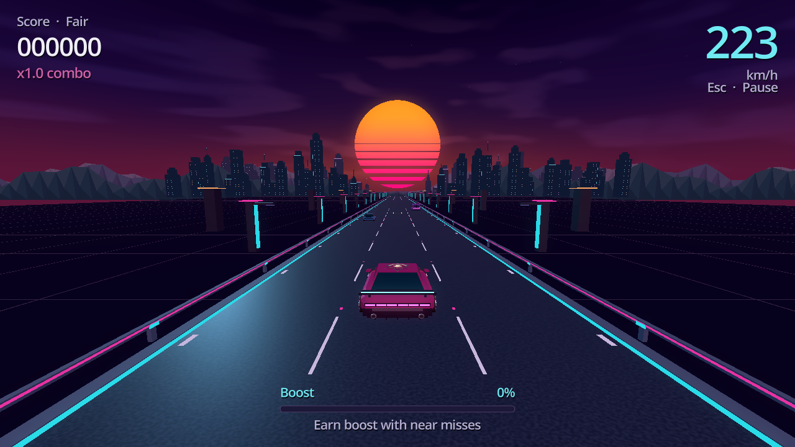
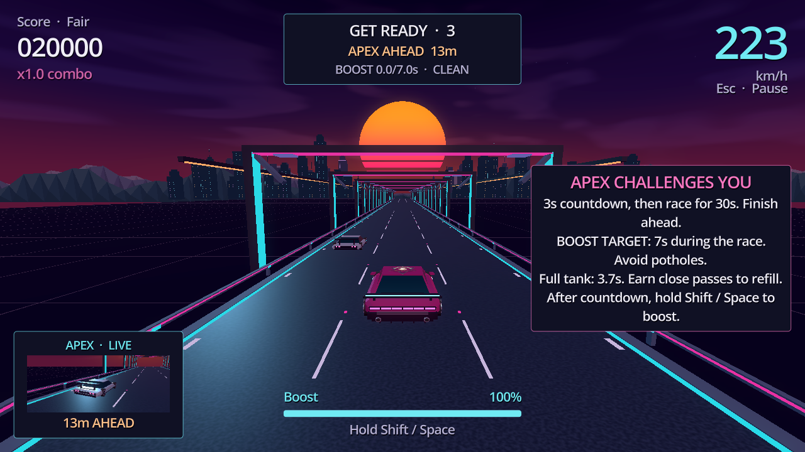
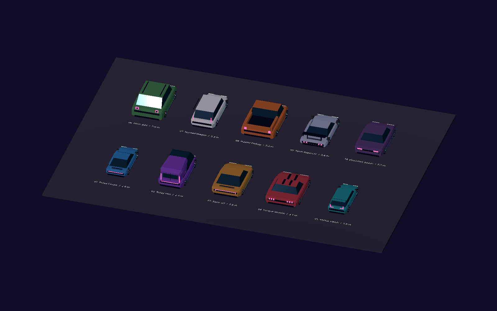

# Synthwave Drive

A Godot 4.6 arcade endless racer: weave through futuristic traffic, brake for random speed traps, earn fine points when caught speeding, avoid potholes and closed work lanes, earn boost from close passes, and escape police. The hidden sySTEMatic Secret level adds pursuits after mistakes and reusable continuation codes. Named leaderboards run locally. Built with GDScript, procedural meshes, shaders, original synthesized audio, and the supplied sySTEMatic Robotics logo. No plugins are required.

## Run

Open `project.godot` in Godot 4.6 or newer and press **F5**, choose a mode, then choose **Start driving** or press Enter and enter your driver name. Every new round starts with a short driving practice; select **Skip**, press Enter or controller A to start the normal run immediately. From a terminal with Godot on PATH, run `godot --path .` in this folder.

Windows players can download the ZIP from [GitHub Releases](https://github.com/Arlechino00/Drive-game/releases), extract the complete folder, and run `SynthwaveDrive.exe`. Godot does not need to be installed to play an exported build.

Android test builds use `.godot/releases/Android/SynthwaveDrive.apk`: copy the APK to an Android phone and open it to install, allowing installation from that file source if Android asks. The package supports Android 7.0+ with an OpenGL ES 3-capable ARM64 or ARMv7 device. It is signed for direct testing; the published Windows release remains separate. Build instructions are in [CONTRIBUTING.md](CONTRIBUTING.md).



## Controls

| Input | Action |
| --- | --- |
| A / Left Arrow | Steer left |
| D / Right Arrow | Steer right |
| Controller left stick | Steer |
| Hold Shift / Space / controller right trigger | Spend boost |
| Hold S / Down Arrow / controller left trigger | Brake; overrides boost |
| Escape | Pause / resume; return from Settings |
| R | Restart after a crash or while paused |
| Enter | Start from the title screen; skip driving practice |
| Controller D-pad / A / B | Navigate menus / accept or skip practice / back |
| Controller Start | Pause / resume |
| F3 | Toggle seed, difficulty wave, road section, encounter/pool counts, and FPS |
| F8 or Ctrl+Shift+S on title | Hidden Secret Mode access dialog |

On Android, play in landscape. Hold the left/right arrows to steer and hold **BOOST** or **BRAKE** with another finger. Brake overrides boost. Tap **PAUSE**, or use Android Back, to pause; Back also closes dialogs and Settings. Switching apps pauses the run and clears held controls. Returning leaves the game paused until you resume. The **Secret** title button opens code entry; the phone keyboard's Done action confirms driver names and codes.

Phone controls and menus fit the display's safe area, with larger touch targets and phone-specific instructions. New phone installs start with Low graphics, reduced effects and reduced camera shake; these preferences remain adjustable. Fullscreen and window-size choices are desktop-only. To preview the touch interface on a computer, run `godot --path . -- --mobile-controls` and click/hold its controls.

Menus support mouse, keyboard and controller focus. Switching away from the game pauses it and clears steering momentum; returning leaves it paused until you resume. Settings are available from the title and pause screens. English / Romanian language, master volume, camera shake, visual effects, fullscreen, render quality, and window size are saved locally. Both the title and Settings contain language selectors; switching preserves current run, dialogs and typed names. Missing language in older saves defaults to English. **Low** removes glow; **Balanced** keeps the original look; **High** adds 2× edge smoothing. Window choices are Current, 1280×720, 1920×1080, and 2560×1440, fitted to the usable display area. Fullscreen uses the display size. Quality choices preserve traffic visibility and collision bounds.

## Interface

The interface scales with the rendered game area, keeping menus and controls readable in small windows and at high resolutions. Larger headings, mode cards, and a bright main action make the title, pause, and results screens easier to navigate. Secondary actions sit side by side, with visible keyboard focus and control hints. Driver names support up to 24 visible Unicode characters; the last name is prefilled, and restart retains the driver. Leaderboard shows the best ten drivers on this computer, with separate rankings for each mode and resumed Secret runs.

Opening or switching the leaderboard refreshes scores from other open game instances. Damaged or unsupported leaderboard files are preserved as unique `.recovered-*` backups before supported records are restored. If a save cannot be written, a valid driver can still start, with a notice that the name could not be saved.

The HUD gives speed the strongest emphasis, with score and combo on the left. A wider boost bar shows remaining fuel as a percentage, or an infinity symbol in Infinite Boost mode. Empty Fair fuel explains how to earn more. A pothole warning counts down the repeat-hit window, and the boost hint explains the shorter recovery period. Police results sit beside the stopped cars and clearly mark disqualified scores. Settings use clear percentage values, larger slider handles, and a high-contrast fullscreen switch. Text stays sharp as the interface scales.

## Car and branding

The player car has a futuristic wedge body, sloped tinted canopy, round tires with five-spoke rims, slim headlights, a low aero wing, segmented rear lights, hood vents, diffuser, and hollow exhaust tips. Metallic magenta paint and cyan accents keep its silhouette distinct from traffic. Steering, body lean, and boost trails remain attached to the model.

The original sySTEMatic Robotics logo appears beside the title, on the car's roof, and as the Godot application icon. Its colors, transparency, and proportions are preserved; distance filtering keeps the roof graphic stable in the chase view. The source is `logo.png`, copied unchanged from the supplied image.

The project is **all rights reserved**. Official builds may be downloaded and played personally; reuse or redistribution requires permission. See [LICENSE](LICENSE) and the separate [branding notice](docs/BRANDING.md).

## Modes

Choose **Fair** or **Infinite Boost** on the title screen. Fair uses earned boost that drains while held. Infinite Boost gives unlimited fuel: hold Shift, Space, or the controller's right trigger for sustained boost; release to cruise. Traffic, collisions, and scoring still work in both modes.

The selected mode is shown in the HUD and results, retained on restart, and can be changed after returning to the title screen. Records are separate so unlimited-boost runs do not overwrite Fair records. Existing high-score saves belong to Fair mode.

**sySTEMatic Secret** unlocks through **F8** (or **Ctrl+Shift+S**, for keyboards where F8 is a media key) on the title and the code in `config/secret_mode.cfg`. The supplied phrase is `SYSTEMATIC`; change it in that file for your event. There is no hard-coded fallback. Missing/empty config keeps the mode locked, and a changed phrase invalidates the saved unlock when selecting/restarting Secret. Successful entry reveals the third mode card. This level uses a blue night palette and finite earned boost.

In Secret, traffic impact, a second pothole within ten driving seconds, or entering roadworks starts a moving police chase. Traffic costs up to 1,000 points and 30 m/s; repeat holes cost up to 500 and 18 m/s; roadworks cost up to 750 and 26 m/s. Speed recovers over four seconds, and limited boost remains usable during recovery. Police approach from 64 m behind with finite acceleration and three seconds of grace. Arrest needs sustained positioning: five seconds of strong contact/boxing pressure, with gradual 12%/s decay when pressure breaks. Escape requires every unit beyond 100 m, capture cleared, and five seconds of disengagement. Steering and traffic can create separation without Boost; impacts reset disengagement without teleporting police. Heat 0–6 dispatches up to three patrol, pursuit, interceptor or heavy units. A live rear view and capture meter show their actual positions and pressure.

After captured Secret police have arrived, **Bribe / resume** accepts the reusable `resume_code` beside `access_code` in `config/secret_mode.cfg` (supplied value: `SYSTEMATIC-RESUME`). Both codes stay valid until manually edited; there is no daily rotation or expiry. Each submission reads the current file immediately. An operator checks the post like and shares the configured resume code. One continuation per run preserves points, distance and remaining fuel, clears immediate hazards, and starts at cruise speed. HUD/results mark it Resumed; its final ranking and records are separate. Fair/Infinite never offer continuation. See [local event setup](docs/local-event-setup.md) for editing both codes and local save recovery.

## Driving and scoring

All modes have seeded random 30, 50, 70, 80, 90, 120, 130 or 200 km/h sectors between unlimited stretches. Ordinary traffic approaches posted speed gradually; player cruise is unrestricted until measured by radar. Racing Apex and pursuing police ignore posted limits. Police close on your actual speed, including Boost, with a 14–29 km/h role advantage on clear road and finite acceleration. At 300 km/h in a 30 zone, pursuing police can exceed 300 km/h. Traffic, turning and close formation still affect their motion. Cameras appear in about 65% of early restricted sectors, rising toward 92% in long runs. Camera-free sectors show No radar reported. Roadside signs, camera props and a brief HUD warning announce traps. Warning distance is at least 320 m and grows to cover braking distance plus one second of reaction; later sector schedules retain that budget. Radar RNG remains separate from traffic RNG.

Hold the brake to decelerate at 7 m/s² down to 28.8 km/h. Braking from 300 to 30 km/h takes about 10.7 seconds and 491 m; the dynamic warning now gives enough distance for responsive braking. Brake overrides boost and consumes no fuel. Survival progression continues during braking. Extended crawling outside radar approaches, posted-limit sectors and damage recovery has a twenty-second grace period, then makes the round ineligible for personal records and rankings. A warning precedes the persistent Outside rankings badge. Five seconds at normal pace restores the grace timer before it expires; brief brake releases do not reset it. Boost and driving remain available in unranked rounds. Traffic uses signed relative motion and drains between mixed-speed and static waves.

A legal radar pass avoids police. Speeding deducts 100 + ceil(10 × excess km/h) score points and raises Heat according to speed and repeated violations. Active pursuits receive a location update, lose disengagement progress and gain bounded reinforcements where Heat permits. Radar never grants points or ends a chase on a timer. Active Apex racing can continue alongside police. Pause freezes pursuit/radar progression; restart clears run Heat, traps and fines.

- Forward travel is automatic. Steering retains controlled acceleration/release, body lean, yaw and wheel feedback. The player footprint is 3.45×1.5×6.15 m. Traffic visuals and collision dimensions grow together by 8%; gaps smaller than the car collide without exaggerated invisible boxes.
- Cruise starts at 130 km/h and continues increasing smoothly through survival time (95%) and reference distance time (5%), at five times the original progression pace. An integrated unboosted run measured 309/387/476/554/792 km/h at 5/10/20/30/60 minutes. Boost adds 38 m/s. Actual player motion has a remote technical ceiling of 7,140 km/h so the finite 2,400 m preview can still contain a safe spawn distance; the target curve continues growing. Gradual FOV, vibration, engine pitch and wind audio strengthen speed while keeping traffic readable.
- Fair runs start with 40% boost. Near misses restore 18%, or 24% for clearance below 0.35 m. Holding boost drains 27% per second. After running empty, release the button before engaging newly earned charge. Infinite Boost runs keep the meter full.
- A close pass earns a base 100, 250, or 500 points according to clearance. It counts only after the traffic vehicle's rear clears the player, once per pass. A collision cancels the reward.
- Close passes add 0.5 to the combo, up to x5.0. The combo resets after 4.5 seconds without another close pass, or on impact. Bonuses use the combo; distance earns 10 points/m before combo and risk bonuses. High speed, Heat, pursuit/capture pressure and Apex add risk rewards; collision and fine penalties still apply.
- In Fair/Infinite, a pothole deducts up to 500 points, breaks the combo, and immediately removes 18 m/s (about 65 km/h), with a minimum speed of 27 m/s. Cruise speed recovers over four seconds; boost is unavailable during recovery and consumes no fuel. Another pothole in less than ten driving seconds ends the run. A hit at exactly ten seconds starts a new window. Pause freezes both timers.
- Roadworks close one or two lanes. In Fair/Infinite, entering a closed lane ends the run and invalidates its score; existing score, distance, combo, and speed records are preserved. Police approach from behind with a siren and park beside the stopped player. Invalid runs show **SCORE INVALID** and cannot earn a new record.
- In Fair/Infinite, traffic collision freezes the run and adds short sparks, impact shake, and sound. The player and the matching struck traffic model remain stopped while a futuristic police car pulls up alongside. Game Over shows the ending reason, score, best score, distance, top combo, and near-miss count. Restart is immediate, including during the police approach. Pothole failure and barrier collisions use the ordinary results view.
- Valid ranked rounds are saved once on game over, Menu, Restart or Quit; practice and unranked rounds are excluded. Score, longest distance, highest combo, and top speed persist per mode in `user://highscore.cfg`: existing `scores` for Fair, `scores_infinite`, `scores_secret`, and `scores_secret_resumed`. Preferences use `user://settings.cfg`. Named leaderboard entries use `user://player_records.cfg`; saved access unlocks use `user://secret_access.cfg`. Record and leaderboard writes merge the latest saved results under a lock and replace files atomically, preserving results from another open game. Malformed score fields are recovered independently. A valid current access code repairs damaged saved unlock data.
- Syntactically damaged score files are backed up unchanged before rebuilding the current run's records. Results and settings show save-failure notices. Windows can reclaim a save lock from a proved-dead owner; uncertain or live ownership remains protected. Preferences apply immediately and save atomically after 0.35 seconds without another change, with pending changes flushed on quit/backgrounding. See [save recovery instructions](docs/local-event-setup.md) for legacy or damaged locks.

## Traffic, road, and atmosphere

Ten readable futuristic traffic designs have faceted bodies, tinted glass, round tires, and distinctive red rear lights. The original **Pulse Coupe** (blue), **Relay Van** (purple), and **Solar GT** (amber) are joined by **Torque Muscle** (crimson, racing stripes and triple rear lamps), **Vector Hatch** (teal, short upright hatch and L-shaped lamps), **Atlas SUV** (green, raised body and roof rails), **Nomad Wagon** (white, long roof and vertical lamps), **Hauler Pickup** (orange, open cargo bed), **Apex Supercar** (silver, low wedge, wing and four round lamps), and **Executive Sedan** (violet, formal trunk and rectangular lamps). The magenta player car remains separate.

Each model retains its distinct proportions, with width and length enlarged by 8% for road presence. Visible geometry, collision boxes, close-pass clearance and navigation share the catalog dimensions. Immutable meshes/materials are cached, and each pooled actor builds each model only once. The traffic capacity is twenty actors; tests verify it stays bounded.

### Rare Apex race

After 1,800 m, Apex has a 6% draw per eligible traffic vehicle and at least 2,500 m between spawns. Meeting the real car starts a three-second countdown and thirty-second race, including during pursuit. The rival uses explicit draft, pressure, pass, traffic avoidance and recovery states. Blocking it directly ahead for about 0.7 seconds triggers a safe adjacent pass; observed repeated blocking biases its next side. It predicts visible traffic merges and swept footprints, never future random spawns. Throttle starts at 48 m/s² and scales with cruise speed to keep the launch deficit within an 80 m budget. Cruise headroom is 3 m/s ahead or 6 m/s when chasing, plus modest age aggression. Brief bursts can exceed your actual boosted speed; sustained Boost and traffic navigation can still create genuine separation. Apex overtakes an idle unboosted driver on clear road throughout the tested progression. Recovery handles speed loss and displacement while active; a real player collision retains the mode's existing collision consequences. The reused opponent camera continues to show the actual rival.

To win, finish strictly ahead, meet a boost target randomly chosen from **four, five, six, or seven seconds total**, and hit **no potholes** during the race. The challenge and race HUD show that encounter's target and your progress. Targets replay with the run seed using a separate random stream, preserving traffic layouts. A pothole permanently marks that race failed even after recovering; ordinary damage and collision rules still apply. Fair/Secret drivers must save or earn enough fuel through near misses. Infinite Boost drivers must still engage boost. Traffic is limited to one ordinary encounter per row during the race, keeping room for the rival and an escape route.

A win awards **20,000 points** and **ten seconds of unlimited boost**. Hold the usual boost input to use it; it preserves finite fuel, clears the empty-fuel input lock, and returns to earned fuel when it expires. The reward does not bypass Fair pothole recovery. Infinite Boost remains unlimited after the reward timer expires. Race, popup, and reward timers freeze while paused.

Apex's victory message appears only when the rival finishes ahead. Finishing ahead while missing the Boost target or hitting a pothole shows a failed challenge with that reason; ties and interrupted races have separate messages. Fair/Infinite receive no additional penalty or police chase. Secret starts the existing moving police pursuit for public-road racing and speeding, without an extra collision penalty. A Secret impact during the race ends the challenge as a loss and applies its existing impact consequence once; a newly started chase keeps its normal 64 m gap. Restart/menu clear the race and its reward. Wins/losses, timer boundaries, all ten model bounds, pooled reuse, and rival lane safety are covered by dedicated tests. Eight generated-traffic cases cover two seeds and every 4–7 second target with actual steering, finite starter fuel, legitimate close-pass refills, and enabled collisions.





Ordinary traffic follows posted sector speed with 8 m/s² acceleration; unlimited-road traffic becomes faster during long runs. Paired rows keep a common speed and an adjacent safe-lane chain. After ten minutes, single-actor waves introduce mixed speeds and planned overtaking while reserving an outside corridor. Waves clear before switching their corridor or stationary hazards. Static hazards and racing Apex keep their own movement rules.

Potholes use amber markers and jagged rims; roadworks use orange/white barricades, lamps, cones and a roller. Static rows never block all lanes. Row spacing grows with current closing speed, preserving at least 0.72 seconds plus the relevant vehicle lengths for adjacent-lane steering. Look-ahead scales to four seconds of travel (285–2,400 m spatial budget). New encounters remain at least 1.2 seconds or 70 m ahead after delayed ticks. Sixty-six reusable road chunks cover the expanded horizon; the camera draws the range needed for current speed, and traffic has a fixed twenty-actor capacity. Long radar distances and Romanian captions grow toward the road to retain their screen margin.

Cruise speed starts at 130 km/h and grows at five times the original pace: roughly 309 km/h after five minutes and 387 km/h after ten minutes of unboosted driving. It continues increasing on longer runs while traffic density rises and falls in smooth waves. Recovery windows reduce density without abruptly changing handling.

Sixty-six recycled 40 m road chunks provide continuous coverage. They share one movement phase to prevent seams from accumulated position drift. Three authored visual categories repeat in 400 m sections: **Open Grid**, **City Edge**, and **Neon Canopy**. A lighter entrance chunk leads into each section. The straight road and lane coordinates remain consistent while props change ahead of view.

The highway uses a shared seamless asphalt texture, restrained surface highlights, pale lane dashes, magenta divider studs, cyan edge lights, shoulders, and metal guardrails. A darker, wider ground grid frames the road. City buildings have stepped rooftops and window patterns; canopy arches include diagonal braces and inset light panels. Small repeated grid and window details use MultiMesh batches, created once per chunk.

The backdrop uses a sliced orange-to-pink sun behind three distinct faceted mountain ranges, a warm rose-to-violet sky, soft irregular cloud wisps, and sparse fixed stars. Two skyline layers contain 72 buildings with stepped crowns, landmark towers, rooftop antennas, and restrained cyan, violet, and amber windows. The city's structure and lights use ten fixed mesh batches, reducing the previous background's separate building draws. A central valley frames the road and sunset. Secret mode switches the sky, sun, halo, mountains, and skyline to a consistent blue palette using the same resources. Warm key lighting and a cool rim light reveal the car facets, while driving lights and light fog retain hazard clarity. The effects setting adjusts glow, atmospheric detail, skyline emission, sun emission and halo, exhaust trails, crash effects, and HUD animation. Camera shake can be turned off separately.

Original synthesized engine, wind, boost, capture warning, near-miss, crash, pothole, police siren, UI and looping arpeggio sounds use Music, Engine, SFX, and UI buses. Playback nodes are reused across restarts. The siren stops once police have parked. Setting visual effects to zero keeps emergency lights steady instead of flashing.

## Architecture

| File | Responsibility |
| --- | --- |
| `scripts/game.gd` | State transitions, integration, records, input, clean shutdown |
| `scripts/touch_drive_controls.gd` | Reusable per-finger steering/brake/boost/pause overlay, cancellation and input reset |
| `scripts/player_car.gd` | Arcade steering, stable collision footprint, car visuals |
| `scripts/vehicle_mesh.gd` | Cached procedural vehicle hulls, canopies, and detail meshes |
| `scripts/traffic_models.gd` | Ten traffic identities, distinct silhouettes/lights, shared mesh/material catalog |
| `scripts/apex_race.gd` / `apex_race_ui.gd` | Rare opponent race rules, traffic-aware rival, countdown/challenge/results/reward UI |
| `scripts/run_progress.gd` | Score, timed combo, boost, pothole damage timers, run validity and statistics |
| `scripts/difficulty_director.gd` / `stage_two_tuning.gd` | Continuous time/distance cruise, tiers, density waves and centralized physical budgets |
| `scripts/heat_controller.gd` | Radar severity/chains, Heat decay and risk scoring |
| `scripts/localization.gd` / `localization/` | Keyed English/Romanian captions and live refresh |
| `scripts/obstacle_spawner.gd` / `obstacle.gd` | Seeded encounter pool, reachable traffic/static waves, relative movement, distinct contact signals and close-pass detection |
| `scripts/hazard_visuals.gd` | Cached pothole and roadworks geometry |
| `scripts/police_aftermath.gd` | Reusable police approach, matching stopped traffic replicas, emergency lights and results camera framing |
| `scripts/police_pursuit.gd` | Sustained capture, physical multi-unit roles/traffic planning, real disengagement and pooled mirror visuals |
| `scripts/speed_enforcement.gd` / `radar_display.gd` | Independent seeded sectors, swept radar readings, fine penalties, braking-aware warnings and fixed roadside/HUD props |
| `scripts/player_records.gd` / `secret_access.gd` | Validated bounded local rankings, configured unlock, manually configured reusable resume and persistent access unlock |
| `scripts/save_lock.gd` | Shared save ownership and conservative recovery of abandoned Windows locks |
| `scripts/road_manager.gd` / `road_chunk.gd` | Spatial chunk ring, section metadata, shared materials, decoration |
| `scripts/visual_world.gd` / `shaders/` | Procedural horizon and effects controls |
| `scripts/chase_camera.gd` / `crash_effect.gd` | Camera response and reusable impact sparks |
| `scripts/game_ui.gd` | HUD, reusable popup, menus, settings |
| `scripts/community_ui.gd` | Modal driver/access/resume entry, local ranking tabs and pursuit mirror |
| `scripts/game_settings.gd` / `drive_audio.gd` | Preferences and bounded audio playback |

The player stays near world origin while the road and encounters move toward the camera. Traffic movement subtracts its cruise speed from player speed; static hazards move with the road. This avoids growing world coordinates and keeps seeded rows predictable. Steering runs before traffic samples the current physics tick, so close-pass clearance matches the actual path. Contact signals identify the hazard type and retain the struck object for aftermath framing. Police and stopped traffic replicas have no physics actors, so the ending animation cannot trigger further collisions.

Pause freezes steering, encounters, score, combos, boost, damage timers, camera, and gameplay feedback. Menus remain interactive. After a police ending, driving and scoring remain frozen while only the police scene and camera advance. Restart clears transient sounds, police actors, damage, invalidation, sparks, rewards, pass state, and camera state without rebuilding the scene.

## Reproduce a run

Normal starts generate a fresh nonnegative seed. F3 shows it in editor/development runs; exported production builds hide debug telemetry. Launch with that seed to reproduce traffic layouts:

```text
godot --path . -- --seed=2468
```

A supplied seed is reused on restart. Invalid or negative seed arguments keep ordinary randomized runs. Player choices, survival time and distance progression still affect encounter timing.

## Stage Two validation

The [October 6 audit follow-up](docs/audit-fixes-2026-10-06.md) covers round settlement, ranked pace, desktop focus, controller menus, continuous coaching handoff, traffic/police contacts, high-speed budgets and varied adaptive music.

### In-game tutorials

Every new round begins with interactive coaching in English or Romanian, even if you have completed it before. Short prompts stay over the moving road while you steer, brake, use Boost, avoid one marked car and brake for a practice radar. The standard intro mentions Secret only by directing you to the sySTEMatic Robotics team for details. Selecting the unlocked sySTEMatic level gives a separate practice sequence: steer, use Boost, learn capture pressure, escape and finish.

Practice stays out of normal scores and records. Complete it, click/tap **Skip**, or press Enter to begin a clean normal run. Pause freezes the practice and its progress. **Tutorial** on the title screen replays the selected mode's intro through the driver-name prompt. During paused practice, **Tutorial** resumes the current lesson. During a normal paused run, it resumes driving with basic steering, braking and Boost prompts; dismissing those prompts keeps the current run and earned progress.

See [Stage Two report](docs/stage-two-report.md) for current speed, police, Apex, localization, high-speed and build evidence. Historical measurements below describe earlier builds; their old capped-speed/timer rules are superseded by Stage Two.

## Validation

On Windows, run:

```powershell
./tests/run.ps1 -GodotPath 'path/to/Godot_console.exe' -Capture
```

Omit `-GodotPath` when Godot is on PATH. Omit `-Capture` for headless checks only. The runner isolates saves in `.godot/validation/appdata`, writes logs in `.godot/validation`, and fails on a nonzero exit or engine/script errors or warnings.

Checks cover editor loading, keyboard steering/start/restart, pause freezing, collisions at both dividers against every traffic type, twelve alternating escape lanes at 288 km/h, real near misses and duplicate exclusion, both modes and separate records, combo/boost rules, settings, seed replay, responsive UI, and clean window close. Hazard checks use real Area3D contacts in both modes, test exact ten-second and repeated physics-tick boundaries, score clamping, speed recovery, held-boost lockout, frozen paused timers, and record-file preservation after disqualification. Police checks cover all traffic types, stopped actors, arrival/parking, effects-off lights, viewport framing, and 200 reuses. UI checks cover 960×540, 1280×720, 1920×1080, 2560×1440, 2560×2048, and 3440×1440 windows, including hazard warnings, recovery hints, both police result types, transformed bounds, effective text sizes, actual mouse hits, keyboard mode selection, and settings controls. Maximum-speed generation runs eight seeds over 128 km and 200 restarts. Traffic tests cover eight boost-speed runs and 52.8 km of relative encounter motion; mixed-speed hazard tests cover 149.6 km, reachable adjacent lanes, catch-time separation, and delayed-frame spawning. World tests cover 232.5 km and 200 resets. Pools, scene nodes, materials, seams, and reachable lanes remain bounded.

Named ranking checks cover Unicode, deterministic ties, limits, malformed saves, stale-instance merging, save contention and read/write/rename failures. Record recovery checks cover malformed fields, preserved valid statistics, stale-instance score merging, mode isolation, equal-score ties, lock ownership and failed-write retry. Access checks cover configured unlock/revocation, damaged-unlock repair, reusable config-based resume, live edits, invalid/missing values and unlock-save contention. Secret integration checks exercise real impacts, clean escape, finite damaged boost, capture, eligibility and separate resumed scores, including a real R-key restart after changing the access phrase. Pursuit resources are checked across 200 reuses. Encounter regressions cover swept corner impacts at 60 Hz, exactly one outcome, contact-time aftermath placement and synchronous pool reset safety.

The continuous checks drive through actual physics collisions with an input-based test driver in all three modes for 10,800 physics frames each: three simulated minutes at 60 Hz. Those runs deliberately speed through radars to exercise score penalties and sustained police capture; the Infinite driver holds boost for at least 90% of its frames. Separate three-minute Fair/Infinite runs press the actual S brake key at the dynamic camera warning and must clear at least two radars with no fines. Generated finite-fuel Apex tests isolate race win rules; dedicated integration verifies that radar, police and an active Apex coexist. Route planning uses actual approach speeds, full encounter occupancy windows, and the time needed to steer between lanes. Scene nodes and live memory are monitored. A separate real-time rendered run is available:

```text
godot --path . --max-fps 60 --script res://tests/continuous.gd -- --render-soak
```

Append `--infinite-boost` to test sustained maximum boost in that run.
Append `--secret` to test the locked level with test-only access data.

For an uncapped 600-frame renderer benchmark:

```text
godot --path . --disable-vsync --fixed-fps 60 --script res://tests/continuous.gd -- --render-benchmark
```

Append `--secret --pursuit` for a 600-frame measurement with the live police mirror active throughout. That isolated mirror benchmark keeps other encounters inactive; the normal continuous checks exercise full procedural generation.
Append `--infinite-boost --apex` for a 600-frame measurement with the live Apex screen active, including the distant-rival road backdrop. This fixture keeps other encounters inactive.

For cold-start normal traffic, including lazy model construction without catalog prewarming:

```text
godot --path . --disable-vsync --fixed-fps 60 --script res://tests/continuous.gd -- --cold-benchmark
```

This draws 1,800 frames with generated traffic and writes startup time, median, 95th/99th percentile, maximum, and lazy-construction frame times to `.godot/validation/cold-benchmark.json`. It requires a renderer; headless runs cannot measure display performance. The first run on the RTX 2000 Ada at 2560×2048 had a 3.89 ms median, 5.39 ms 95th percentile, 6.22 ms 99th percentile, and 142.67 ms maximum. Nine frames built additional models, with a 6.55 ms maximum for those frames. These are a short local measurement, not a guarantee for other hardware.

Pushes and pull requests run the pinned Godot 4.6.1 validation suite in GitHub Actions. Each process has a timeout. Tagged releases run validation, export Windows64, verify external and bundled event configuration plus unlock/capture/resume, and publish the tested ZIP. Build instructions are in [CONTRIBUTING.md](CONTRIBUTING.md); release notes are in [CHANGELOG.md](CHANGELOG.md).

Direct checks use the normal Godot user-data folder. Prefer the Windows runner to protect personal saves, or redirect APPDATA to `.godot/validation/appdata` before running direct commands.

`-Capture` renders eleven screenshots at the configured resolution in `tests/`: both mode selections, Fair gameplay and boost, Infinite Boost gameplay, city, canopy, real near-miss feedback, pause, game over, and settings. It also renders six UI states in 960×540, 1280×720, and 1920×1080 windows as `ui_*_<width>.png`, two hero views as `car_front.png` and `car_rear.png`, and three-vehicle lineups as `traffic_front.png` and `traffic_rear.png`. Six additional 1280×720 views show `pothole.png`, `pothole_warning.png`, `roadworks.png`, `police_approaching.png`, `police_roadworks.png`, and `police_crash.png`; warning and police captures are triggered by actual contacts. The ten-model contact sheet is `traffic_models.png`. Actual Apex challenge, boosted victory/reward, and Secret loss/police views are `apex_challenge.png`, `apex_win.png`, and `apex_secret_loss.png`. Rival-screen captures show far ahead, far behind, and a nearby trailing Apex as `apex_rival_ahead.png`, `apex_rival_behind.png`, and `apex_near_rival.png`. Ordinary captures contain the rendered area and exclude any side bars from the saved aspect ratio. Model-review captures use a temporary test window and fixed camera; project settings remain unchanged. Capture framing deliberately places encounters and advances sections; independent gameplay tests verify actual behavior.

Thirteen new 1280×720 captures show driver entry, access, unlocked title, Secret level, distant/close pursuits, escape, capture, resume entry, assisted driving/results, and both Secret ranking partitions. Police and escape shots use actual contacts and clean recovery.

Radar captures add warning, legal 30 km/h braking, a 200 km/h sign, speeding without a radar, and actual speeding/police views at 960×540, 1280×720 and 1920×1080: `radar_warning_<width>.png`, `radar_braking_<width>.png`, `radar_sector200_<width>.png`, `radar_speeding_no_radar_<width>.png`, and `radar_police_<width>.png`. Their checks verify text stays inside the HUD panel and clears central feedback and pothole warnings. Rule checks cover every posted limit, camera-free sectors, exact-limit passes, once-only warnings/readings, sampled speed at a swept crossing, seed replay and random duration bounds. Integration checks cover real brake/boost priority, all three modes, post-crossing chase timing, capture precedence, 500 m rear-camera coverage, low-speed damage, simultaneous Apex/police and 200 fixed-prop updates. A real-input braking check measures 300→30 km/h travel and verifies the dynamic warning includes that braking distance and reaction time. Sector traffic and braking checks cover smooth posted-speed changes, independent Apex/static motion, negative relative motion, returning cars, complete wave separation and bounded mixed-speed generation.

Mobile input checks deliver actual touch events for simultaneous steering/boost/brake, independent finger releases, drag-out/cancel handling and empty-fuel release. Integration checks cover virtual-keyboard submission, pause/resume, Android Back, backgrounding and the same physical braking and dynamic radar-warning behavior. `-Capture` adds 57 mobile views at 854×480, 960×540 and 2400×1080: menus, name entry, settings and save failures, populated rankings, access/resume codes, driving, pursuit, escape/capture, resumed results, pause, Apex and safe areas. They verify submitted field signals, effective text sizes, touch targets, full panel bounds, radar text enclosure and HUD separation; the notch fixture reserves side and bottom insets. These desktop-rendered checks do not verify native software-keyboard appearance or physical-phone performance.

Background captures are `background_sunset.png`, `background_city.png`, `background_canopy.png`, `background_secret.png`, `background_effects_off.png`, and the 1920×800 `background_wide.png`. The earlier matching view is preserved as `background_before.png`. The background check exercises 200 palette/effects changes, verifies all 19 world nodes and 41 resource identities remain stable, checks mountain valleys and skyline clearance, and preserves driving lights, fog, and actual hazard materials and collision bounds.

Before the radar update, the 2026-10-04 release passed all 39 checks with Godot 4.6.1 and Compatibility rendering, without engine/script errors or warnings. Those checks included the four audited bugs, preserved save recovery, external configuration, rendering settings, real finite-fuel Apex victories, all ten model widths, live opponent visibility, Secret outcomes, and bounded world/pool reuse. The seeded three-minute drives covered 11.05 km each in Fair and Secret, and 14.31 km in Infinite Boost, with at most 5,377 scene nodes and stable monitored memory. Infinite held actual boost for all 10,800 frames in that run. Updated settings and Apex countdown captures passed and were inspected. Independent review reran the persistence and pursuit checks. Logs are in `.godot/validation/`.

The extended radar/braking update passed the complete **46-check** suite on 2026-10-04 with Godot 4.6.1, without engine/script errors or warnings. Fifteen radar captures passed across three sizes, with representative views inspected. Three-minute speeding runs survived five radar chases per mode, with stable memory and at most 5,183 nodes. The Fair brake-input run cleared four radars; the Infinite brake-input run still incurred five radar pursuits despite braking at each warning. Real input verified 300→30 km/h braking at 10.72 seconds and 490.5 m. Updated sector tests exercised 360 km/h and retained at least 0.7 seconds between actual encounter footprints, with a maximum pool of eight. Independent traffic review reproduced and covered an Apex lane-change false collision; its correction preserves genuine contacts. The final integration check also verifies radar reports and camera props stay hidden beyond 320 m even at maximum speed.

An earlier uncapped 600-frame Secret pursuit benchmark averaged 208.8 rendered FPS on the RTX 2000 Ada laptop GPU with stable monitored memory and the shared-world rear viewport active throughout. This historical measurement isolates the pursuit view and predates the audit fixes. The cold normal-traffic measurement above is another historical frame-time report.

The Android adaptation passed the complete **48-check** headless suite on 2026-10-05 with Godot 4.6.1, without engine/script errors or warnings. Eighteen mobile captures passed and representative small-phone driving/Apex views were inspected. Independent review reran touch, mobile integration, community UI and mode checks. The final ARM phone APK passed signature, manifest, architecture, bundled-file and alignment verification. An x86_64 variant rendered the shipped game full-screen on an Android 15 emulator using host graphics. Native launcher start, steering, boost, gradual braking, touch Pause, Android Back and background/return checks passed; returning remained paused. The receipt is `.godot/validation/android-emulator/verification.json`. Native software-keyboard appearance and physical-phone performance remain unverified: this emulator exposes an internal hardware keyboard, for which Godot suppresses its software keyboard even after the AVD keyboard setting is disabled. Automated checks verify keyboard submission signals; native hardware entry and the Start button were exercised.

The subsequent audit improvements passed the complete **51-check** automated suite and all ten rendered capture groups on 2026-10-05 with Godot 4.6.1, without engine/script errors or warnings. This includes 57 phone views at three sizes, damaged-score backup/recovery, visible save failures, atomic/debounced preferences and transient-failure retry, live/dead/competing lock ownership, and delayed-frame near-pass retirement with reset/reuse protection. Eight-seed endurance covered 128 km and 200 restarts with a maximum pool of eight; continuous Fair, Infinite Boost and Secret runs kept stable memory. Representative small-phone rankings, code entry, results and settings failures were visually inspected. Independent review reran saving, mobile integration, quit and encounter checks. This validates the project source; the earlier APK/emulator receipt predates these audit improvements.

## Current limits

Road variation is visual: the road keeps straight lanes without curves or elevation. Ordinary traffic uses controlled mixed-speed overtakes after ten minutes; Apex also uses its tested passing and lane-change behavior during races. Audio uses lightweight synthesized material. Physical controller response, sound balance by ear, and subjective difficulty tuning still benefit from live play sessions. Performance depends on hardware and display settings.
